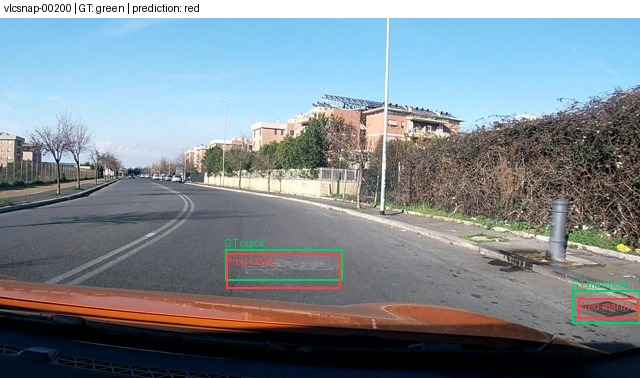
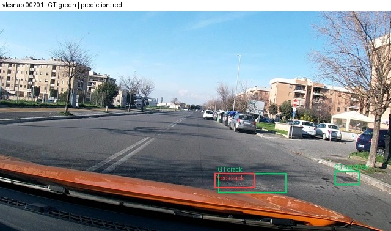
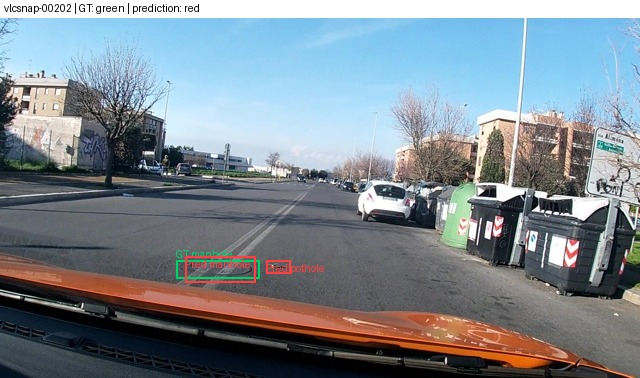
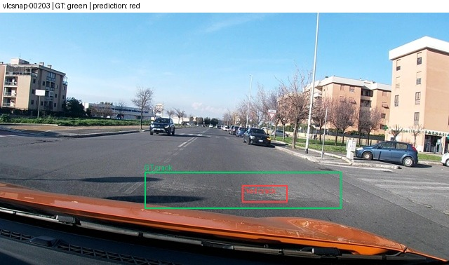
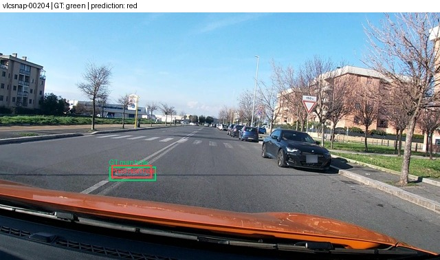
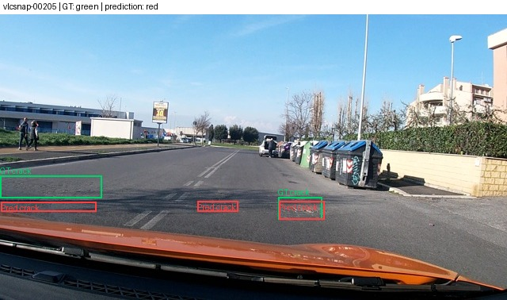

Họ tên: Dương Văn Thành
Mã sinh viên: 2A202602368
dataset_version: d10-21e4070301

## Bảng tổng hợp

Các số trong bảng được chép từ sáu JSON official scorer mới nhất ở report/evidence/ và các metadata train gắn trong E1–E4. F1, CI95, F1 từng lớp và FP/ảnh dùng 6 chữ số thập phân; VRAM và thời gian làm tròn 3 chữ số để dễ đọc.

| Mã | Setup | Tham số huấn luyện | VRAM đỉnh (GB) | Phút | F1 | CI95 | FP/ảnh | F1 pothole | F1 crack | F1 manhole |
|---|---|---:|---:|---:|---:|---|---:|---:|---:|---:|
| E0 | Zero-shot | 0 | — | — | 0.072948 | 0.049751–0.098232 | 1.183279 | 0.113744 | 0.000000 | 0.139535 |
| E1 | LoRA LLM, rank 16 | 33,030,144 | 6.357 | 43.222 | 0.250657 | 0.214699–0.291631 | 1.334405 | 0.128342 | 0.191977 | 0.500000 |
| E2 | E1 + projector fp32 | 142,135,296 | 8.051 | 44.135 | 0.360568 | 0.321461–0.401119 | 1.093248 | 0.177966 | 0.311475 | 0.621429 |
| E3 | E2 + LoRA ViT, rank 16 | 148,426,752 | 8.228 | 52.686 | 0.451319 | 0.411871–0.495205 | 0.861736 | 0.370044 | 0.379661 | 0.666667 |
| E4-rank4 | E3 baseline, rank 4 | 118,935,552 | 7.789 | 52.826 | 0.423592 | 0.382684–0.464776 | 0.961415 | 0.317073 | 0.348718 | 0.666667 |
| E4-rank64 | E3 baseline, rank 64 | 266,391,552 | 10.079 | 53.916 | 0.416071 | 0.371025–0.460419 | 0.977492 | 0.339623 | 0.330128 | 0.661972 |

Các lượt SFT dùng 300 successful optimizer steps, batch 2, tích luỹ gradient 4, seed 42, LR 2e-4, toàn bộ 1.422 ảnh train và tọa độ norm1000. E3 và hai lượt E4 có 2 lần GradScaler bỏ qua overflow; các lần đó không tính vào 300 bước thành công. E4 chỉ đổi rank so với baseline E3: rank 4/alpha 8 và rank 64/alpha 128. E3 được chọn làm baseline vì có F1 cao nhất trong E1–E3 trên test.

Transfer audit: artifacts của năm runs, mỗi run có checkpoint 100/200/300, đã được tải về từ runtime Kaggle và bản saved output Version `358449192` (dùng để hoàn tất E4). Tổng cộng 77 files / 8.508.613.345 bytes; từng file có SHA256 và từng checkpoint được kiểm tra metadata, adapter safetensors, tensor count và projector fp32 khi áp dụng. Inventory tại [model_artifact_transfer.json](report/evidence/model_artifact_transfer.json). Base pretrained weights không nằm trong gói này; tổng số tham số kiến trúc ở Câu 1 vẫn là ước tính GUIDE. README PEFT dùng chung ở một số checkpoint đã được deduplicate như ghi trong inventory; weights/config/run metadata riêng của từng checkpoint vẫn được giữ. Raw E0 JSONL không có trong runtime hoặc bundle tải về nên Câu 2 chỉ dùng số liệu scorer tổng hợp.

## 10 câu hỏi

### Câu 1 — Kiến trúc

Theo quy mô ước tính trong GUIDE, LLM cộng embedding khoảng 4,0B tham số, ViT khoảng 415M; projector gồm visual.merger khoảng 27M và visual.deepstack_merger_list khoảng 82M, tổng khoảng 109M. Tổng model khoảng 4,44B. Đây là ước tính kiến trúc trong GUIDE, không phải phép đếm mọi tham số từ checkpoint tải về; base pretrained weights không có trong artifact transfer. Đối chiếu các adapter safetensors và projector đã tải, trainable params gồm: E1 LoRA 33.030.144; E2 LoRA 33.030.144 + projector 109.105.152 = 142.135.296; E3 LoRA 39.321.600 + projector 109.105.152 = 148.426.752; E4 rank4 LoRA 9.830.400 + projector 109.105.152 = 118.935.552; E4 rank64 LoRA 157.286.400 + projector 109.105.152 = 266.391.552. Số module LoRA quan sát được là 252 ở E1/E2 và 348 ở E3/E4.

### Câu 2 — E0

E0 có parse_valid_rate 0,533762 và F1 0,072948. Scorer đếm 368 false positive và 547 false negative trên 311 ảnh. Lớp crack thất bại rõ nhất: 133 FP, 299 FN và 0 TP; pothole cũng chỉ có 12 TP/121 GT và manhole có 24 TP/163 GT. Đây là các lỗi boxes sai lớp/vị trí và bỏ sót đối tượng theo matching của scorer. Raw E0 JSONL không còn trong Kaggle runtime và không có trong gói tải xuống này; tôi không thể trích dẫn một dòng output thô trung thực. Tôi không suy dựng ví dụ từ evidence tổng hợp.

### Câu 3 — Sai thang tọa độ

Tôi dùng nguyên E3 test predictions, cùng 311 test IDs và dataset_version, rồi chấm hai lần bằng scripts/score.py. Với norm1000 đúng, F1 = 0,451319 (CI95 0,411871–0,495205). Cố ý đọc cùng số tọa độ như pixel cho F1 = 0,000000 (CI95 0–0), dù parse_valid_rate vẫn 1,0. Scorer chia x cho 640 và y cho 360 trước khi đổi sang 0–1000; vì raw coordinates vốn đã chuẩn hóa, box trở nên sai kích thước và lệch theo trục, nên không còn IoU dương đủ để match. Kết quả đối chiếu được lưu trong report/evidence/e3_norm1000_rescore.json và e3_pixel_mismatch_rescore.json.

### Câu 4 — Mask loss

Prompt có chỉ dẫn, marker hội thoại và token ảnh; mục tiêu là sinh JSON detections chứ không học nhắc lại prompt hay token ảnh. Tôi đặt labels của toàn bộ prefix prompt thành -100, giữ labels cho JSON câu trả lời và token kết thúc <|im_end|>. Nếu tính loss trên prefix, số token không phải target sẽ kéo objective sang tái tạo template/marker thay vì học lớp và tọa độ. Khi batch, vị trí padding của labels cũng là -100 nên chỉ token đáp án được giám sát.

### Câu 5 — Lượng tử hóa và projector

QLoRA giữ trọng số base LLM ở NF4 và học adapter; Params4bit là biểu diễn packed cho suy luận, không phù hợp để cập nhật đầy đủ hàng trăm triệu tham số projector. Vì vậy quá trình load bỏ lượng tử hóa model.visual và lm_head, giữ chúng fp16; các merger và deepstack merger trainable được đưa về fp32. E2/E3 train 109.105.152 tham số projector và lưu chúng riêng cùng LoRA adapter; khi restore, mã xác minh đủ key/shape và nạp projector fp32. Guard đã kiểm tra ViT/head không bị lượng tử hóa trong runtime.

### Câu 6 — Chia theo phiên quay

Các frame cùng session liền kề có thể gần trùng cảnh. Chia ngẫu nhiên có thể đưa frame gần giống vào cả train và test, làm test đo nhận diện lại cảnh thay vì khái quát sang session mới, dẫn tới F1 cao giả. Split cố định theo session: train 1.422 ảnh (pothole 1.074, crack 1.750, manhole 691); val 276 (66, 470, 103); test 311 (121, 299, 163). Audit train ghi nhận 3.515 box nguồn; một crack ở vlcsnap-00058 có YOLO height=0 nên bị loại khỏi target train duy nhất, giữ lại ảnh và 3.514 box được giám sát. Split/GT val và test không bị sửa.

### Câu 7 — So sánh E1/E2/E3

F1 tăng từ E1 0,250657 lên E2 0,360568 (+0,109911), rồi E3 0,451319 (+0,090751). CI95 lần lượt là 0,214699–0,291631; 0,321461–0,401119; 0,411871–0,495205; các khoảng hiển thị không chồng nhau. Mở projector từ E1 sang E2 thêm 109.105.152 tham số trainable, peak VRAM tăng 1,694 GB và thời gian tăng 0,913 phút. Thêm LoRA ViT từ E2 sang E3 thêm 6.291.456 tham số, peak tăng 0,177 GB và thời gian tăng 8,551 phút. E3 giảm FP/ảnh từ 1,093 xuống 0,862 và tăng F1 crack/pothole rõ rệt; trên lần đo này cả hai phần mở thêm đều đáng giá, dù chỉ có một split test.

### Câu 8 — Giới hạn của test

Test có 311 ảnh; độ rộng CI95 là 0,076932 cho E1, 0,079658 cho E2, 0,083334 cho E3, 0,082092 cho E4 rank4 và 0,089394 cho E4 rank64. Vì vậy chênh lệch nhỏ có thể phụ thuộc mẫu test. E1/E2/E3 có các CI hiển thị tách nhau, ủng hộ xu hướng cải thiện trong split này. E3 và cả hai E4 có CI chồng nhau; không đủ cơ sở nói rank16 tốt hơn rank4/rank64 một cách chắc chắn. Bootstrap CI cũng không thay thế đánh giá trên một test set độc lập lớn hơn.

### Câu 9 — Lỗi theo lớp và ảnh minh họa

E3 đạt F1 pothole 0,370044, crack 0,379661 và manhole 0,666667; pothole thấp nhất, sát với crack. Test có 121 pothole, 299 crack và 163 manhole. Hộp pothole/crack nhỏ hoặc mảnh nên sai lệch tọa độ vừa phải có thể làm IoU rơi dưới ngưỡng; cracks còn thay đổi nhiều về hướng và độ dài. Manhole thường có đặc trưng hình dạng rõ hơn. E0 càng yếu với crack: 0 TP, 133 FP, 299 FN.

Các overlay dưới đây do reporting helper tạo từ official GT và E3 predictions thật; xanh là GT, đỏ là prediction.

vlcsnap-00200 — crack IoU 0,676 và manhole IoU 0,531; cả hai prediction đạt ngưỡng match 0,5.

vlcsnap-00201 — crack prediction chỉ phủ một phần GT (IoU 0,383, dưới ngưỡng); GT manhole không có prediction cùng lớp.

vlcsnap-00202 — manhole được định vị (IoU 0,614); prediction pothole không có GT pothole tương ứng.

vlcsnap-00203 — GT crack dài/rộng nhưng prediction chỉ nằm ở một phần nhỏ (IoU 0,106), minh họa lỗi under-localization.

vlcsnap-00204 — box manhole prediction gần GT, IoU 0,648.

vlcsnap-00205 — crack bên phải khớp GT (IoU 0,767); crack GT thứ hai sát mép trái bị bỏ sót do prediction lệch theo chiều dọc; prediction crack ở giữa không có GT tương ứng.

### Câu 10 — E4

E4 chỉ đổi rank LoRA trên LLM và ViT so với baseline E3 rank16, giữ nguyên config/data/seed/projector. Rank4/alpha8 đạt F1 0,423592 (CI95 0,382684–0,464776); rank64/alpha128 đạt 0,416071 (0,371025–0,460419), còn baseline E3 là 0,451319 (0,411871–0,495205). CI chồng nhau, nên không thể kết luận khác biệt có ý nghĩa từ test nhỏ này. Rank64 dùng 266.391.552 tham số trainable và 10,079 GB peak; rank4 dùng 118.935.552 và 7,789 GB. Trong kết quả này, rank lớn hơn không cải thiện F1 và tiêu tốn nhiều VRAM hơn; bằng chứng chưa đủ để tuyên bố rank4 và rank64 khác nhau đáng kể.

## Nhìn lại

Một nhãn train có YOLO height=0 khiến phép đổi box không thể tạo vùng ground truth có diện tích dương. Tôi audit dữ liệu, loại đúng annotation đó khỏi supervision train, giữ ảnh và nguyên split/GT val/test. E3 và hai E4 gặp overflow gradient fp16; GradScaler giảm scale, bỏ qua hai lần update tương ứng rồi hoàn thành đủ 300 optimizer updates thành công. Test 311 ảnh và CI chồng nhau ở E4 giới hạn kết luận về rank. E0 raw predictions mất cùng runtime cũ nên tôi chỉ báo cáo những gì scorer chứng minh, không dựng output thô.
